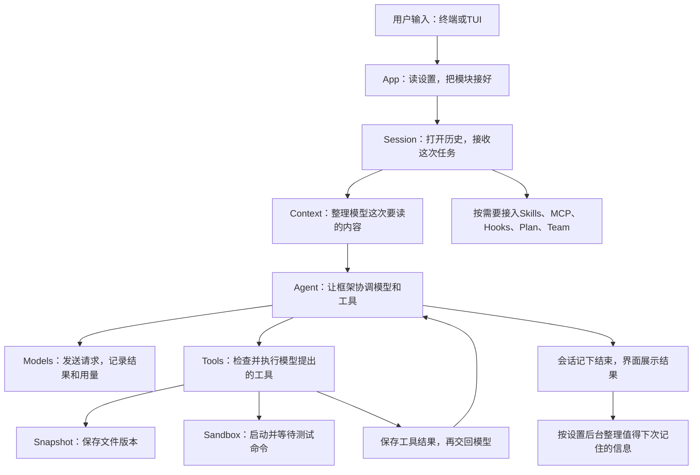

# 00　先跟着一次修代码任务，把整个程序走一遍

假设项目里有一个 `parser.py`。空输入会让它报错，你希望 Agent 找到原因、修改代码并运行测试。这是这本手册贯穿使用的例子，文件名只是为了讲清过程，不要求当前仓库真的有这个文件。

先不急着记目录和类名。我们跟着这句话往下走：**谁收到它，谁去读文件，模型怎样提出修改，程序凭什么允许执行，结果又怎样回到你面前。** 认清这些问题，再展开函数，代码就有了可以对照的事情。

## 1. 用户的话先到哪里

你可以从终端发命令，也可以在 TUI 中输入文字。两种入口最后都要做同一件事：把项目位置、模型设置和可用功能交给应用，再打开一个会话。具体接线从 `compose_application` 开始。

这里的“会话”就是程序用来把这一串对话和执行记录归在一起的对象。修文件通常不只一个动作：先读代码，可能再问你一次，之后修改、跑测试，最后解释结果。程序需要能分清这些动作都属于哪次任务，而不是只保存最后一句回复。

[组装入口这一章](01-application.md)会先解释工作设置，再带你从 `main` 走到 `AgentSession.run`。你会看到十四个功能模块具体各做什么，以及它们什么时候才真正开始工作。

## 2. 发给模型之前，先决定让它读到哪些内容

会话接到“修复 parser.py”后，会先保存用户消息，再准备本轮工作。模型要看到这句任务，还要知道前面聊过什么、已经使用了哪些工具，以及这次允许用哪些工具。

这些信息不总能原样全发出去。对话可能很长，测试输出也可能有几千行。Context 模块负责把保存的历史整理成这次模型需要的消息，并检查长度。你可以先把“上下文”理解成**模型这次实际读到的内容**，而不是另一个神秘的存储系统。

[上下文与压缩](04-context.md)会继续回答：保存在历史里的记录怎样变成输入，内容太多时先做什么，为什么摘要生成后还要确认它对应的历史没有变化。

## 3. 模型提出要读文件，程序再决定能不能执行

准备好输入后，Models 模块创建所选服务的客户端并发送请求。它还会记录请求开始、完成或失败，以及服务返回的token用量。这样，一次暂时失败后的重试不会在用量里凭空消失。

模型可能先返回一个工具调用：“读取 parser.py”。这时框架会把这个调用交给工具执行部分。Tools 模块查到对应实现，检查这次请求里模型是否看到了该工具，以及当前操作是否被允许。检查通过，才真正读取文件；返回的内容再交回模型，让它继续判断该改哪一处。

所以这里有一段往返：**模型需要更多信息 → 请求工具 → 程序检查并执行 → 工具结果交回模型。** [模型请求](03-models.md)、[Agent执行](05-agent.md)和[工具执行](06-tools.md)会把这个往返拆开带读。它们各负责其中一段，合起来才是一次任务。

## 4. 修改文件和运行测试，会多出哪些工作

模型读到代码后，可能提出编辑文件。Snapshot 模块会保存需要的文件版本，供之后查看差异或回退。真正写入仍通过工具执行流程；需要审批时，程序先等用户决定。

接着模型要求运行测试，通常会用到 Bash。此时要检查的已经不只是一个文件路径：命令可能启动子进程、读取环境变量、访问网络，也可能一直不退出。Sandbox 模块因此负责按设置启动进程、限制它能做的事，并在超时或用户取消时等待进程结束。

测试输出仍要回到模型。完整结果会保存，展示给模型和屏幕的内容则可能缩短；想查看更后面的输出，应当读取已保存的结果，而不是为了看日志再运行一次命令。

沿着这一段可以接着读[沙箱与进程](07-sandbox.md)和[文件快照](08-snapshot.md)。前者说明命令怎样运行，后者说明改动怎样留下可核对的版本。

## 5. 模型怎样知道已经做完了

模型看完工具结果，可以继续调用工具，也可以返回最终回答。例如测试失败了，它可能再修改一次；测试成功后，它可以解释改动和验证结果。

这套“请求模型—按需要调用工具—再请求模型”的循环交给 deepagents 建立的执行图处理。项目通过模型、工具、上下文等方法接入这个循环，不在会话里另外写一套循环。

不过，模型返回一句“完成”并不意味着其他记录可以随意省略。程序仍要保存正式消息、工具结果和本轮结束位置，再把完成状态交给界面。团队消息另外通过明确的发送和接收步骤传递，不会因为主Agent完成就自动广播给子Agent。这样，下一次打开历史时，能找到和屏幕结果相对应的记录。

## 6. 哪些能力会按需要加入这条主线

假设你还希望按一套代码审查要求检查修改，Skills 可以提供相应指令。程序先找到Skill，再读入它的文档，让后面的模型请求使用这些说明；如果Skill带有Python工具，真正执行脚本仍要经过工具检查和进程限制。详细过程见[Skills](09-skills.md)。

如果审查需要查外部服务，MCP 可以把已配置服务的工具接进来。连接、发现工具、让模型选择、执行以及外部服务向用户追问，是不同步骤。[MCP这一章](10-mcp.md)会跟着一次外部调用解释它们。

如果你希望编辑前自动检查、执行后自动通知，这类动作可以配置成Hook。[Hooks](11-hooks.md)会说明谁在什么时刻调用它，为什么后台动作的开始、结果和不确定状态要分别记下。

用户可能还有稳定偏好，例如“解释用中文”。Memory 模块负责在合适的时候查找和整理保存的笔记。AGENTS.md 则先由 Context 选定允许读取的路径，再由 Agent 交给框架读取。[记忆这一章](13-memory.md)会区分读取AGENTS说明、召回已有笔记、模型主动记笔记和任务结束后的后台整理。它们不会因为都叫“记忆”就同时发生。

较大的修改可以先进入[计划模式](14-plans.md)，先让Agent查看和提出方案，用户确认后再改。也可以通过[团队协作](15-team.md)把测试等工作交给子Agent；主Agent仍要收消息、看差异，并按规则确认代码整合。

## 7. 用户取消或关闭窗口后，刚才的对象怎么办

模型客户端、MCP连接、命令进程、Hook和摘要任务，都可能还在等待结果。负责创建或接收它们的对象，也要负责在结束时关闭它们。取消按钮不能只是让屏幕停止刷新，而让命令继续在后台跑。

同一进程中的TUI可以在等待审批时保留当前运行，收到答案后继续。非交互CLI遇到等待输入会以退出码2结束并关闭会话；新进程虽然可以打开历史，却不能复活旧进程里那张执行图。

[会话与恢复](12-session.md)会把这些情况接起来解释；[TUI这一章](16-ui.md)则从用户输入、看到进度、回答审批一直讲到取消和退出。到这里，最开始那句任务才真正走完了。

## 回头看，框架在整条路上分别帮了什么

现在再看框架名，它们已经能对应到刚才的具体动作。

| 框架 | 在刚才哪一步出现 | 项目还要自己处理什么 |
|---|---|---|
| deepagents | 建立请求模型与使用工具的执行图，也提供Skills、Memory等扩展接口 | 接入实际工具、文件读取、历史和权限规则 |
| LangGraph | 运行这张图，保留当前进程里的执行状态，等待并接收当前问题的答案 | 保存可重启阅读的会话记录，处理旧工具结果不确定的情况 |
| LangChain及模型SDK | 把消息、工具和请求转换成所选服务接受的格式 | 判断使用哪套设置、记录每次请求、限制真实工具执行 |
| LangMem | 提供查找、管理和后台整理记忆的方法 | 决定笔记放哪里、什么时候整理、什么内容能写入、怎样撤销 |
| Textual | 显示终端界面并处理输入事件 | 把用户动作交给同一个应用，会话退出时真正关闭工作 |

每个模块章会在走完具体步骤后，再回头说明用到了哪段框架接口。你不必靠这张表猜它们怎样调用。

## 用一张图记住刚才走过的路线

箭头表示主要协作关系，具体调用先后仍看各章的步骤说明。可选功能不会在每次任务里全部启动。

## 读函数时，用这四个问题检查自己是否理解了

**它为什么被调用？** 回到前一步，找出缺少的信息或尚未完成的工作。例如，模型还没读到parser.py，所以才请求read_file。

**它拿到了什么？** 对照调用参数，不把一个配置对象、会话对象或工具结果当成同一种东西。

**它做完后，把什么交回去了？** 有的函数返回数据，有的创建对象，有的只保存记录。返回一个能工作的方法，不等于那个工作已经执行过。

**接下来是谁继续？** 可能是普通函数继续往下调用，也可能是框架等到模型请求前再调用一个预先交给它的方法。手册会把这种关系写出来，不让你只凭箭头猜。

你可以先沿[组装入口](01-application.md)读完整主线，遇到哪一步不清楚，再回到对应模块章。最后用[怎样验证修改确实有效](17-evaluation.md)核对结果，或用[诊断与本地维护](18-operations.md)理解运行环境和数据管理。
